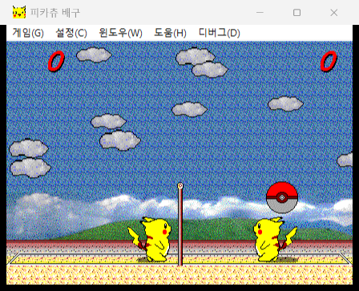

# Pikachu Volleyball

A C++ source port of the 1997 Windows game **피카츄 배구 / Pikachu Volleyball**
(SACHI SOFT / SAWAYAKAN), built as a native Win32 program.



## Features

* 1P vs CPU and 2P versus, 5 / 10 / 15 point matches
* the game's 432x304 court, sprites, palette animation, cloud drift and waves
* DirectSound effects with stereo panning, MCI background music
* keyboard and joystick input, fixed 25 fps update loop
* resizable window: the 432x304 picture is stretched over the client area

More screenshots are in `docs/screenshots/`.

## Building

Requirements: Windows with Visual Studio (Desktop development with C++), or
mingw-w64.  The game data is already in `assets/`.

### MSVC (32-bit, small static binary)

```bat
build_msvc.bat
:: -> build\pikachu.exe
```

The script finds Visual Studio with `vswhere`, runs `vcvars32`, and links with
`/MT /NODEFAULTLIB` against the tiny runtime in `src/mini_crt.cpp`.  The result
is about 456 KB and imports only `KERNEL32`, `USER32`, `GDI32`, `WINMM` and
`DSOUND`.

### MinGW-w64

```sh
make -j4
# -> build/pikachu.exe
```

Debian/Ubuntu: `apt install g++-mingw-w64-i686 binutils-mingw-w64-i686`.
MinGW uses its normal C/C++ runtime; `src/mini_crt.cpp` is skipped there.

### CMake

Works with both MSVC and MinGW:

```sh
cmake -B build-cmake -G "MinGW Makefiles"
cmake --build build-cmake
```

## Running

```bat
build\pikachu.exe                 :: title screen
build\pikachu.exe --demo          :: CPU vs CPU, 15 points
build\pikachu.exe --demo --quick  :: CPU vs CPU, 1 point
```

Controls:

* Player 1 (left side): arrow keys, **Space** or **Enter** for the power hit
* Player 2 (right side): **R / F / D / G**, **Z** (also NumPad 8 / 2 / 4 / 6,
  **Z / X**)
* **Esc** pauses; the menu has speed, score, reset and window restore.

In a 1P game the left character is the human player and the right one is the
CPU.

## Layout

```text
src/         game code (App, Game, MatchScene, TitleScene, Player, Ball, Court,
             Screen/Sprite, DirectSound, input)
res/         resource script (menu, icon, bitmaps, WAVs)
assets/      game bitmaps, icon and waves
tools/       screenshot.ps1
docs/        screenshots
```

## License

Source code: MIT (see `LICENSE`).  The game and the data in `assets/` remain
the property of their authors; see `NOTICE.md`.
